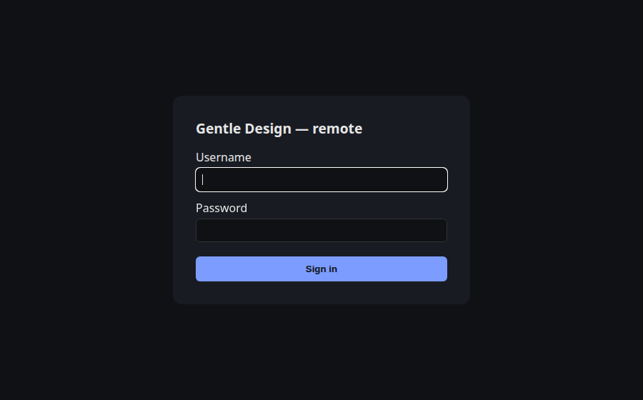

# gs-remote-design

[English](README.md) · **Español**

<p>
  <a href="https://github.com/Gentleman-Programming/gentle-shell"></a>
  Hecho con <a href="https://github.com/Gentleman-Programming/gentle-shell">gentle-shell</a>.
</p>

> Extensión independiente de la comunidad. No es un proyecto oficial de gentle-shell ni está respaldada por sus
> mantenedores. El nombre y el logo de gentle-shell pertenecen a su dueño; ver la
> [política de marcas de gentle-shell](https://github.com/Gentleman-Programming/gentle-shell/blob/main/TRADEMARKS.md).

Una extensión de [Gentle Shell](https://github.com/Gentleman-Programming/gentle-shell) para ver el canvas de
**gentle-design** desde otra máquina cuando Gentle Shell corre en remoto (homelab, VPS, AWS o cualquier otro servidor).

Elegís un puerto, por ejemplo `30000`, y abrís `http://<ip-o-host>:30000/` en el navegador. La primera visita pide
usuario y contraseña. No hace falta túnel SSH, cliente VPN ni servicios de terceros.

<p align="center">
  
</p>

## Cómo funciona

```
navegador ──► <ip>:30000  (relay gentle-remote: login, cookie de sesión, lista de permitidos)
                 │
                 ▼
          127.0.0.1:<puerto aleatorio>/<token>/  (canvas de gentle-design, sin cambios)
```

- El canvas sigue escuchando solo en `127.0.0.1`, en su propio puerto aleatorio, tal como lo trae Gentle Shell.
- La extensión encuentra el canvas a través del servicio de diseño de gentle-design (`gentle:desktop:design-service`) y
  lo sigue cuando se vuelve a abrir con otro puerto o token. Lee la URL actual del servicio en cada petición, incluso en
  servidores sin pantalla donde un fallo al abrir el navegador de escritorio puede omitir la notificación de apertura.
- Las peticiones con sesión iniciada se reenvían con el `Host` y el `Origin` que espera el canvas. El
  `Content-Security-Policy` del canvas se reescribe del origen loopback a la dirección que usó tu navegador, así los
  artboards se siguen mostrando dentro del canvas.
- El stream de recarga en vivo se reenvía sin buffer.

## Instalación

Con el launcher de Gentle Shell (instala en el home propio de Gentle Shell):

```bash
gentle-shell install https://github.com/AncientGear/gs-remote-design
```

Reiniciá Gentle Shell después; aparece `/gentle:remote` (`/gentle:remote help` lista los subcomandos).

`gentle-shell install <origen>` ejecuta `pi install <origen>` de Pi contra el home de Gentle Shell: el home aislado por
defecto, `--link` para tu home de Pi, o `--home <dir>`. Usá el mismo selector de home con el que lanzás, antes del
subcomando (`gentle-shell --link install ...`). Un `pi install ...` a secas instala en el home de Pi, que Gentle Shell
no lee salvo que lo lances con `--link`.

Otros orígenes y comandos de paquetes:

```bash
gentle-shell install git:github.com/AncientGear/gs-remote-design            # igual que la URL
gentle-shell install git:github.com/AncientGear/gs-remote-design@<tag|branch> # fijar una ref
gentle-shell install ./gs-remote-design                                       # un clon local
gentle-shell list                                                             # comprobar que está instalado
gentle-shell update git:github.com/AncientGear/gs-remote-design               # actualizar
gentle-shell remove git:github.com/AncientGear/gs-remote-design               # desinstalar
```

Una instalación por git clona el repositorio en el home y ejecuta `npm install` ahí, así que `git` y `npm` tienen que
estar en el `PATH`. El paquete no tiene dependencias de runtime. Un origen fijado con `@<ref>` se queda en esa ref al
actualizar.

## Uso

```text
/gentle:remote                    estado: on/off, URL, canvas abierto/cerrado, sesiones
/gentle:remote user <nombre>      usuario que se pide en la primera visita
/gentle:remote password           define la contraseña en un prompt (se guarda como hash scrypt)
/gentle:remote port 30000         puerto donde escuchar (1024-65535, por defecto 30000)
/gentle:remote bind 0.0.0.0       dirección donde escuchar: 0.0.0.0, ::, o una IP (LAN, Tailscale, WireGuard)
/gentle:remote allow 192.168.1.0/24   aceptar solo estas IPs/CIDRs (repetir para agregar)
/gentle:remote allow remove <entrada> | allow clear
/gentle:remote on | off           abrir o cerrar el puerto
/gentle:remote logout-all         cerrar la sesión de todos los navegadores
/gentle:remote help
```

Primera configuración típica:

```text
/gentle:remote user saul
/gentle:remote password
/gentle:remote port 30000
/gentle:remote on
/gentle:design                    abrí un diseño; después entrá a http://<ip-del-servidor>:30000/
```

- `on` se niega a abrir el puerto hasta que haya usuario y contraseña configurados.
- La contraseña nunca se acepta por línea de comandos, solo en el prompt, así no queda en el historial. El prompt
  muestra lo que escribís, así que asegurate de que nadie esté viendo tu pantalla.
- La configuración se guarda en `<agent dir>/gentle-remote.json` con modo `0600`. Con `on`, el relay vuelve a arrancar
  con la siguiente sesión de Gentle Shell y se cierra cuando termina la sesión.
- Cambiar el usuario o la contraseña cierra la sesión de todos los navegadores. Cambiar el puerto o el bind reabre el
  puerto.

## Seguridad

Los comentarios, "Implement this" y otras acciones del canvas mandan prompts al agente, y el agente ejecuta comandos
en tu servidor. **Cualquiera que inicie sesión puede dirigir al agente.** Elegí la contraseña en consecuencia.

- Las sesiones usan una cookie aleatoria `HttpOnly`, `SameSite=Lax` (12 horas). La cookie es `Secure` detrás de un
  proxy HTTPS que envíe `X-Forwarded-Proto: https`.
- Después de 5 logins fallidos, una IP queda bloqueada 15 minutos.
- Los POST desde otro origen se rechazan, tanto para el formulario de login como para las acciones del canvas. Las
  páginas del relay usan la política de referrer `same-origin` para que los formularios nativos de login/logout
  conserven su origen sin filtrar referrers a otros sitios; los orígenes opacos (`null`) se siguen rechazando.
- Los archivos de artboards (`files/*`, `system.html`, `assets/inspector.js`) corren en un origen opaco con sandbox
  desde el que los navegadores no envían cookies. Esas rutas de solo lectura se sirven sin cookie y solo las protege el
  token aleatorio del canvas. Todo lo demás requiere sesión.
- **Detrás de un reverse proxy** todos los clientes llegan al relay desde `127.0.0.1`, así que el bloqueo por IP es
  compartido: si alguien falla 5 logins, también te bloquea a vos por 15 minutos. `X-Forwarded-For` no se considera
  confiable.
- El relay no fija el header `Host` (así funciona con cualquier IP o nombre DNS). Una página de DNS rebinding puede
  alcanzarlo pero no tiene cookie de sesión, así que solo obtiene los archivos de artboards protegidos por token
  descritos arriba; restringí la exposición con `allow` o `bind` cuando importe.
- **HTTP plano:** sin TLS, la contraseña y la cookie viajan sin cifrar. Usalo en una LAN o VPN, restringilo con
  `allow`, o poné un reverse proxy HTTPS adelante (Caddy: `reverse_proxy 127.0.0.1:30000`, con
  `/gentle:remote bind 127.0.0.1`).

## Lo que la extensión no puede hacer por vos

- **Firewall:** abrí el puerto en el sistema operativo (`sudo ufw allow 30000/tcp`) y en tu proveedor (security group de
  AWS, firewall del VPS).
- **NAT / CGNAT:** un homelab detrás de un router necesita port forwarding, y una conexión con CGNAT no se puede
  alcanzar desde afuera.
- **Abrir el canvas:** el servicio de diseño permite que una extensión observe el canvas, pero no que lo abra. Abrilo
  con `/gentle:design` o con el agente. En un servidor sin pantalla, ignorá el aviso de "browser could not be opened".
- **Compare:** el canvas solo enmarca previews en el `localhost` del navegador, así que no puede mostrar una app que
  corre en el servidor.

## Desarrollo

```bash
npm test     # node --experimental-strip-types --test tests/*.test.ts (Node >= 22.6)
```

Gentle Shell carga los fuentes TypeScript directamente; no hay paso de build.
